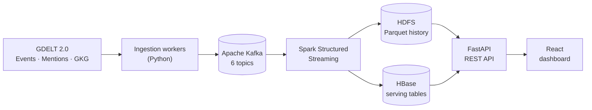
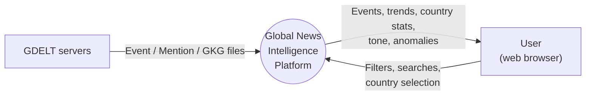
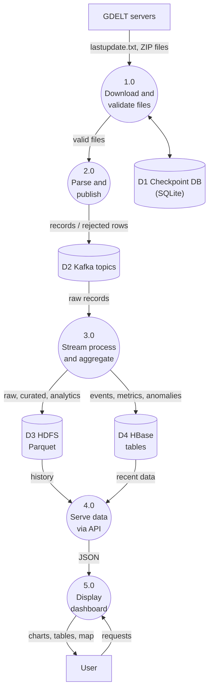
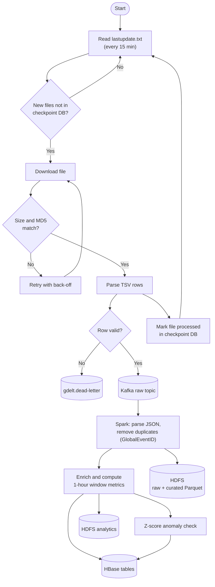
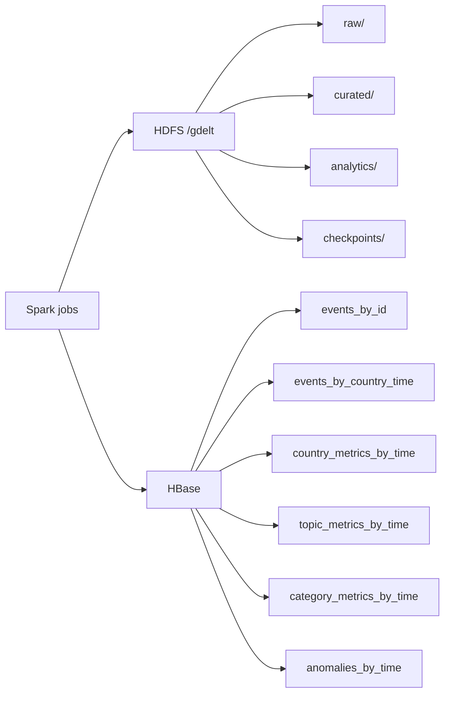
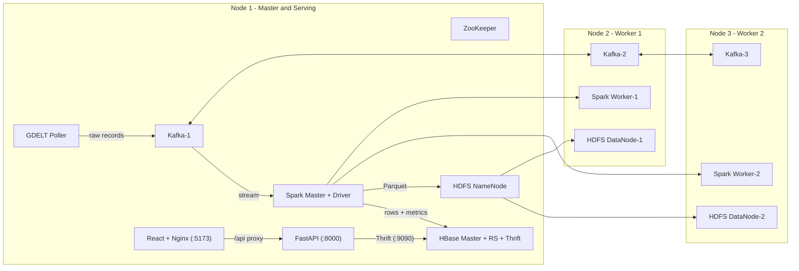

# Global News Intelligence & Monitoring Platform

**Project Report**

| | |
|---|---|
| **Course** | CSBB 422 – Big Data Analytics |
| **Programme** | B.Tech – Computer Science and Engineering |
| **Institution** | National Institute of Technology Delhi |
| **Session** | 2026–2027 |
| **Team** | Makindra Singh (231210066), Mohit (231210071), Nikhil Sharma (231210076), Shashank Yadav (231210095) |
| **Submitted to** | Dr. Himadri |

---

## 1. Abstract

This project is a distributed big-data platform that continuously ingests global event data from the **GDELT 2.0** project, streams it through **Apache Kafka**, processes it with **Spark Structured Streaming**, stores history in **HDFS** (Parquet) and serving data in **HBase**, and presents the results through a **FastAPI** backend and a **React** dashboard. It supports deployment across three physical machines (about 8 GB RAM each) or as a 3-node simulated Docker Compose cluster on a single workstation.

## 2. Problem Statement

GDELT publishes new Events, Mentions and GKG files every ~15 minutes. Handling this data with a single script or database does not scale. The project builds a pipeline that downloads each new file once, validates it, streams it, computes time-windowed metrics and anomalies, stores it for both history and fast lookup, and serves it to a dashboard.

## 3. Objectives

1. Poll GDELT for new files and never process the same file twice.
2. Validate downloads (size and MD5) and quarantine malformed records.
3. Publish records to Kafka topics.
4. Use Spark Structured Streaming to parse, deduplicate, enrich and aggregate records.
5. Detect unusual event-volume spikes.
6. Store raw/curated/analytics data in HDFS and query tables in HBase.
7. Expose the data through a REST API and a 10-page React dashboard.
8. Deploy across three nodes.

## 4. Data Source

GDELT 2.0, discovered through `https://data.gdeltproject.org/gdeltv2/lastupdate.txt`.

| Dataset | Columns | Used for |
|---|---|---|
| Events | 61 | Events, country metrics, categories, map |
| Mentions | 16 | Article mentions of each event |
| GKG | 27 | Themes (topics), tone, persons, locations |

- Country-level analysis and the map use `ActionGeo_CountryCode` (where the event happened), not `Actor1CountryCode` (actor affiliation).
- `AvgTone` is the tone of the reporting text, not public sentiment.

## 5. Technology Stack

| Layer | Technology |
|---|---|
| Ingestion | Python 3.11, requests, Click CLI, SQLite checkpoint (`records_accepted` / `records_rejected`) |
| Message broker | Apache Kafka 3.6 (`confluentinc/cp-kafka:7.6.1`, 3-broker cluster), ZooKeeper |
| Stream processing | Apache Spark 3.5.0 Structured Streaming (PySpark, Scala 2.12, `spark-sql-kafka-0-10`) |
| Distributed storage | Hadoop HDFS 3.2.1 (Parquet via PyArrow, replication factor 2) |
| NoSQL serving | Apache HBase 2.1.3 (`harisekhon/hbase`, HappyBase over Thrift `:9090`) |
| Backend | FastAPI, Pydantic v2, Uvicorn |
| Frontend | React 18, TypeScript, Vite, Tailwind CSS, Recharts, Leaflet, TanStack Query, Nginx |
| Runtime | Java 8 (HDFS/HBase), Java 11 (Kafka/Spark), Node.js 20, Python 3.11 |
| Orchestration | Full 3-node Docker Compose cluster (`docker-compose.yml`) + multi-host templates (`infrastructure/`) |

## 6. System Architecture

### 6.1 Architecture diagram



| Stage | Module | Responsibility |
|---|---|---|
| Ingestion | `src/ingestion/` | Poll, download, validate, parse, publish |
| Messaging | Kafka | 6 topics, 3 partitions each |
| Processing | `src/processing/` | Streaming jobs and aggregations |
| Storage | `src/storage/` | HDFS Parquet writer, HBase client and schema |
| API | `backend/` | 10 routers |
| UI | `frontend/` | 10 pages |

### 6.2 Data flow diagram (DFD)

**Level 0 (context diagram)**



**Level 1**



### 6.3 Flow chart: ingestion to storage



## 7. Implementation

### 7.1 Ingestion (`src/ingestion/`)

| File | Function |
|---|---|
| `poller.py` | Reads `lastupdate.txt` every 15 mins and finds new Events, Mentions and GKG files |
| `downloader.py` | Downloads with retry and back-off; verifies file size and MD5 from the manifest; atomic file rename |
| `checkpoint.py` | SQLite table `ingestion_files` records processed filenames plus `records_accepted` / `records_rejected` counts so files are skipped on restart and daily/weekly telemetry is aggregated live |
| `parsers/` | `events_parser.py` (61 columns), `mentions_parser.py` (16), `gkg_parser.py` (27 columns with `V2.1DATE` / `V2EnhancedThemes` / `V1.5Tone` alias handling & 10 MiB CSV limit); bad rows go to the dead-letter path |
| `kafka_producer.py` | Kafka producer with batching, delivery callbacks and dead-letter routing |
| `metrics.py` | Writes real-time accepted/rejected counts, breakdown and lag to `data/metrics/ingestion_metrics.json` via `poller.py` |
| `cli.py` | Commands: `once`, `poll`, `status`, `replay` (supports `--interval-mins` and `--dry-run`) |

### 7.2 Kafka

Created by `infrastructure/kafka/create-topics.sh` (and `.bat`): 3 partitions, 7-day retention.

| Topic | Purpose |
|---|---|
| `gdelt.events.raw` | Raw events |
| `gdelt.mentions.raw` | Raw mentions |
| `gdelt.gkg.raw` | Raw GKG records |
| `gdelt.events.normalized` | Normalised events |
| `gdelt.analytics` | Computed metrics |
| `gdelt.dead-letter` | Rejected records |

### 7.3 Spark Structured Streaming (`src/processing/`)

**Unified container runner & streaming jobs** (`pipeline_runner.py`, `spark_pipeline.py`, and modular `streams/` scripts):

| Job | Processing |
|---|---|
| `spark_pipeline.py` / `pipeline_runner.py` | Supervised runner watching Kafka watermarks every 30s and submitting `availableNow=True` micro-batches to `spark://spark-master:7077`: parses Events/Mentions/GKG from Kafka, writes raw/curated/analytics Parquet to HDFS, persists HBase event & metric tables, publishes `gdelt.events.normalized` & `gdelt.analytics`, computes country & GKG-topic z-score anomalies, and writes `data/metrics/processing_metrics.json` |
| `events_stream.py` | Standalone Events stream: `dropDuplicates(GlobalEventID)`, 1-hour watermark, CAMEO/QuadClass enrichment → HDFS Parquet + HBase |
| `mentions_stream.py` | Standalone Mentions stream: parse, normalise, 2-hour watermark → HDFS raw/curated Parquet |
| `gkg_stream.py` | Standalone GKG stream: parse themes & tone, 2-hour watermark → HDFS raw/curated Parquet |

**Analytics** (`analytics/` & Stage 2 of `spark_pipeline.py`):

| Module | Output (1-hour windows) |
|---|---|
| `country_aggregator.py` | Per country: event, mention and article counts, average tone, average Goldstein scale, cooperation count (QuadClass 1–2), conflict count (QuadClass 3–4) |
| `topic_aggregator.py` | Per topic from GKG themes; noise prefixes (`TAX_`, `WB_`, `EPU_`, `CRISISLEX_*`, …) are stripped |
| `category_aggregator.py` | QuadClass and CAMEO root-code distribution |
| `anomaly_detector.py` | Statistical z-score spike detection over country and topic timelines (`z ≥ 2.5`, `count ≥ 10`); Stage 2 uses leave-one-out temporal history (`≥ 6` windows) or top-5%-trimmed peer baseline during bootstrap |

`spark_session.py` configures 2 GB limits for 3-PC bare-metal clusters (`infrastructure/`), while the Docker Compose deployment (`docker-compose.yml` + `spark_pipeline.py`) tunes driver/executor heap to `500m` with SerialGC to fit all 15 containers within a single-host Docker VM.

### 7.4 Storage (`src/storage/`)

**HDFS layout** (Parquet, replication factor 2):

```
/gdelt/raw/          events | mentions | gkg      (date_partition=YYYY-MM-DD/hour_partition=HH)
/gdelt/curated/      events | mentions | gkg      (date_partition=YYYY-MM-DD)
/gdelt/analytics/    country_metrics | category_metrics | topic_metrics | anomaly_metrics
/gdelt/checkpoints/  pipeline/{events_raw, mentions_raw, gkg_raw}
```

**HBase tables:**

| Table | Row key | Use |
|---|---|---|
| `events_by_id` | `GlobalEventID` | Event lookup (`event:` & `meta:` CFs) |
| `events_by_country_time` | `SALT_COUNTRYCODE_REVERSETIMESTAMP_EVENTID` | Latest events per country (`8` MD5 salt buckets, `data:` CF) |
| `country_metrics_by_time` | `COUNTRY_REVERSETIMESTAMP` | Hourly country metrics (`metrics:` CF) |
| `topic_metrics_by_time` | `TOPIC_REVERSETIMESTAMP` | Hourly GKG topic metrics (`metrics:` CF) |
| `category_metrics_by_time` | `CATEGORY_REVERSETIMESTAMP` | Hourly CAMEO root metrics (`metrics:` CF) |
| `anomalies_by_time` | `REVERSETIMESTAMP_TYPE_KEY` | Country & topic alerts (30-day TTL, `alert:` CF) |



Reverse timestamps return the newest rows first in a scan. A salt on the country table avoids hot-spotting. Metric tables have a 90-day TTL because history stays in HDFS.

### 7.5 Backend API (`backend/`)

FastAPI with CORS, pagination, date-range parameters, Swagger docs at `/api/docs`, live background-cached probes for Kafka/HBase/HDFS/Spark, SQLite + JSON pipeline telemetry at `/api/health/pipeline`, and HBase Thrift reads (`demo_mode: false` whenever HBase is reachable).

| Router | Endpoints |
|---|---|
| health | `/api/health`, `/api/health/ready`, `/api/health/pipeline` |
| overview | `/api/overview` |
| events | `/api/events`, `/api/events/{id}`, `/api/events/{id}/mentions` |
| topics | `/api/topics`, `/api/topics/{topic}/trend`, `/api/topics/{topic}/countries` |
| countries | `/api/countries`, `/{code}/overview`, `/{code}/events`, `/{code}/topics`, `/{code}/regions` |
| comparison | `/api/compare/countries` |
| analytics | `/api/analytics/categories`, `/tone`, `/cooperation-conflict`, `/anomalies` |
| map | `/api/map/events`, `/api/map/countries` |
| search | `/api/search` |
| regions | `/api/regions/{id}/overview` |

### 7.6 Frontend (`frontend/`)

Served in production via Nginx on `:5173` (proxying `/api/` to `backend:8000`):

| Page | Content |
|---|---|
| Overview | KPI cards, event volume timeline, QuadClass split, top countries, CAMEO categories |
| Events | Full-text searchable (`/api/search`), filterable event table with mention inspection |
| Topics | Interactive GKG theme chart, trend lines, and country distribution breakdown |
| Country | Single-country volume trend, conflict vs cooperation, topic breakdown, events |
| Compare | Multi-country comparison across KPIs and timelines |
| Map | Leaflet world map with tone-coloured Event Markers and Country Volume bubble mode |
| Conflict | Cooperation vs conflict breakdown, Goldstein scores, and CAMEO root categories |
| Sentiment | Tone timeline and distribution (with GDELT tone disclaimer) |
| Anomalies | Country and topic z-score spike cards with severity levels |
| Pipeline | Live connectivity for HBase, Kafka, Spark, HDFS, API plus SQLite/Spark ingestion telemetry |

## 8. Cluster Design

In the Docker Compose deployment (`docker-compose.yml`), all 3 logical cluster nodes run across a dedicated bridge network (`cluster-net`) alongside `kafka-setup` and `hbase-init` bootstrap jobs:

| Node | Services | Exposed Ports |
|---|---|---|
| Node 1 (Master & Serving) | ZooKeeper, Kafka Broker 1, HDFS NameNode, HBase Master/RegionServer/Thrift, Spark Master, GDELT Ingestion (`gnip-ingestion`), Spark Pipeline Driver (`gnip-spark-pipeline`), FastAPI Backend (`gnip-backend`), React/Nginx Frontend (`gnip-frontend`) | UI `5173`, API `8000`, Spark UI `8082`, HDFS UI `9870` (`9000` IPC), HBase UI `16010` (`9090` Thrift), Kafka-1 `9092`/`29092`, ZK `2181` |
| Node 2 (Worker 1) | Kafka Broker 2, HDFS DataNode 1, Spark Worker 1 | Kafka-2 `9093`/`29093` |
| Node 3 (Worker 2) | Kafka Broker 3, HDFS DataNode 2, Spark Worker 2 | Kafka-3 `9094`/`29094` |



Configuration templates for bare-metal 3-PC deployment (`docs/THREE_NODE_CLUSTER_SETUP.md`) are also kept in `infrastructure/` (`kafka`, `hadoop`, `hbase`, `spark`). Start order: ZooKeeper → Kafka Brokers → HDFS → HBase (+ Thrift) → Spark → ingestion → backend → frontend.

## 9. Commands Used

**Docker Compose Quick Start (Full 3-Node Stack)**
```bash
# Build and start all 15 cluster services + bootstrap jobs
docker compose up -d --build

# Check service status & resource usage
docker ps --format "table {{.Names}}\t{{.Status}}"
docker stats --no-stream

# Open UI & management portals
# Dashboard:      http://localhost:5173
# FastAPI Docs:   http://localhost:8000/api/docs
# Spark Master:   http://localhost:8082
# HDFS NameNode:  http://localhost:9870
# HBase Master:   http://localhost:16010
```

**Local / Manual Setup (`infrastructure/` bare-metal)**
```bash
cp .env.example .env
pip install -r requirements.txt
cd frontend && npm install
bash scripts/download-geo-data.sh        # map boundaries and centroids
```

**Storage & Schema Init (manual bare-metal)**
```bash
hdfs namenode -format
start-dfs.sh
hdfs dfs -mkdir -p /gdelt/raw /gdelt/curated /gdelt/analytics /gdelt/checkpoints
start-hbase.sh
hbase-daemon.sh start thrift
python -c "from src.storage.hbase_client import HBaseClient; HBaseClient().create_tables()"
```

**Processing & Ingestion**
```bash
python -m src.processing.pipeline_runner          # managed Spark pipeline loop
python -m src.ingestion.cli once --dry-run        # parse without publishing
python -m src.ingestion.cli poll --interval-mins 15
python -m src.ingestion.cli status
python -m src.ingestion.cli replay data/raw/<file>.zip
```

**Verification**
```bash
pytest tests/ -v
python test_api.py
curl http://localhost:5173/api/health
curl http://localhost:5173/api/health/pipeline
docker exec gnip-namenode hdfs dfs -ls -R /gdelt/curated /gdelt/analytics
bash scripts/check-health.sh
```

<!-- 


 -->


## 10. Output Screenshots

<table>
  <tr>
    <td align="center" width="50%">
      
      <br><b>Global Overview 1</b>
    </td>
    <td align="center" width="50%">
      
      <br><b>Global Overview 2</b>
    </td>
  </tr>
  <tr>
    <td align="center" width="50%">
      
      <br><b>Live Events</b>
    </td>
    <td align="center" width="50%">
      
      <br><b>Topics & Trends</b>
    </td>
  </tr>
  <tr>
    <td align="center" width="50%">
      
      <br><b>Country Intel</b>
    </td>
    <td align="center" width="50%">
      
      <br><b>Country Compare</b>
    </td>
  </tr>
  <tr>
    <td align="center" width="50%">
      
      <br><b>Conflict & Cooperation</b>
    </td>
    <td align="center" width="50%">
      
      <br><b>Sentiment & Tone </b>
    </td>
  </tr>
  <tr>
    <td align="center" width="50%">
      
      <br><b>Anomalies </b>
    </td>
    <td align="center" width="50%">
      
      <br><b>System Health </b>
    </td>
  </tr>
</table>


## 11. Testing

| File | Covers |
|---|---|
| `tests/ingestion/test_events_parser.py` | Events parser & CAMEO mappings (11 tests) |
| `tests/backend/test_events.py` | Events API endpoints (6 tests) |
| `tests/backend/test_health.py` | Health & readiness API endpoints (5 tests) |
| `test_api.py` | End-to-end live API integration checks (18 endpoint checks) |

Run with `pytest tests/ -v` (`22 passed` verified inside `gnip-backend`) and `python test_api.py` (`18/18 endpoints passed`).

## 12. Limitations

- GDELT coordinates can be missing or approximate; many events carry only a country-centroid location.
- `AvgTone` reflects reporting text, not ground-truth sentiment.
- Topics come from GDELT GKG themes (dictionary based), not a trained topic model.
- The z-score anomaly method is simple and can flag regular daily volume cycles or structural country differences during early collection windows.
- While Apache Kafka runs across all 3 nodes (replication factor 2, `min.insync.replicas=2`), ZooKeeper, HDFS NameNode, and HBase Master run as single instances without HA. HDFS replication is 2, so losing both DataNodes can lose data.

## 13. Conclusion

The platform implements the full path from GDELT files to an interactive dashboard: validated incremental ingestion, Kafka transport, Spark streaming with windowed analytics and anomaly detection, HDFS and HBase storage, a 10-router REST API and a 10-page React interface, with configuration and scripts for a three-node deployment.

## References

1. GDELT 2.0 data feed: <https://data.gdeltproject.org/gdeltv2/lastupdate.txt>
2. GDELT Project: <https://www.gdeltproject.org/>
3. CAMEO Manual 1.1b3: <https://data.gdeltproject.org/documentation/CAMEO.Manual.1.1b3.pdf>
4. GDELT GKG Codebook: <https://data.gdeltproject.org/documentation/GDELT-Global_Knowledge_Graph_Codebook.pdf>
