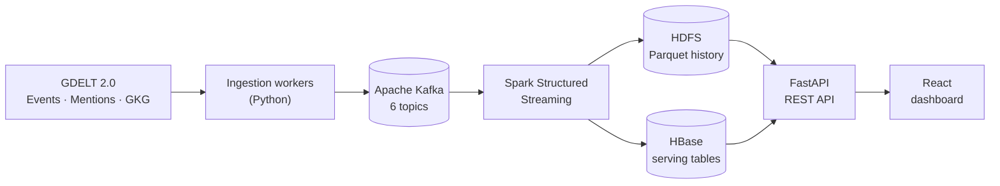
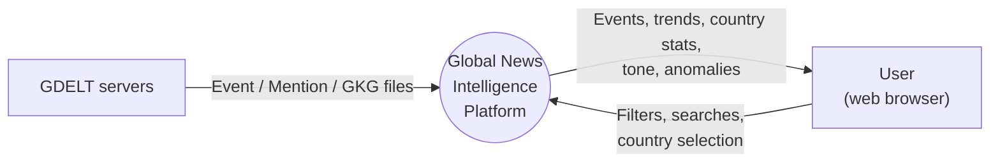
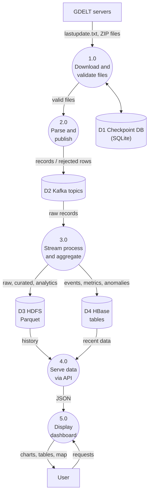
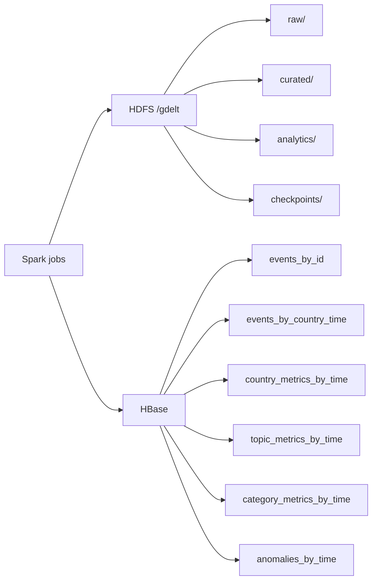
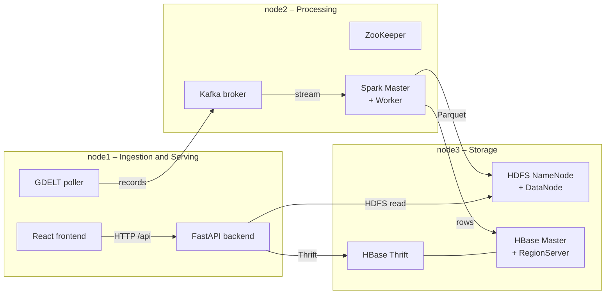

# Global News Intelligence & Monitoring Platform

**Project Report**

| | |
|---|---|
| **Course** | CSBB 422 – Big Data Analytics |
| **Programme** | B.Tech – Computer Science and Engineering |
| **Institution** | National Institute of Technology Delhi |
| **Session** | 2026–2027 |
| **Team** | Makindra Singh (231210066), Mohit (231210071), Nikhil Sharma (231210076), Shashank Yadav (231210095) |
| **Submitted to** | Dr. Himadri |

---

## 1. Abstract

This project is a distributed big-data platform that continuously ingests global event data from the **GDELT 2.0** project, streams it through **Apache Kafka**, processes it with **Spark Structured Streaming**, stores history in **HDFS** (Parquet) and serving data in **HBase**, and presents the results through a **FastAPI** backend and a **React** dashboard. It is designed to run on a cluster of three PCs (about 8 GB RAM each).

## 2. Problem Statement

GDELT publishes new Events, Mentions and GKG files every ~15 minutes. Handling this data with a single script or database does not scale. The project builds a pipeline that downloads each new file once, validates it, streams it, computes time-windowed metrics and anomalies, stores it for both history and fast lookup, and serves it to a dashboard.

## 3. Objectives

1. Poll GDELT for new files and never process the same file twice.
2. Validate downloads (size and MD5) and quarantine malformed records.
3. Publish records to Kafka topics.
4. Use Spark Structured Streaming to parse, deduplicate, enrich and aggregate records.
5. Detect unusual event-volume spikes.
6. Store raw/curated/analytics data in HDFS and query tables in HBase.
7. Expose the data through a REST API and a 10-page React dashboard.
8. Deploy across three nodes.

## 4. Data Source

GDELT 2.0, discovered through `https://data.gdeltproject.org/gdeltv2/lastupdate.txt`.

| Dataset | Columns | Used for |
|---|---|---|
| Events | 61 | Events, country metrics, categories, map |
| Mentions | 16 | Article mentions of each event |
| GKG | 27 | Themes (topics), tone, persons, locations |

- Country-level analysis and the map use `ActionGeo_CountryCode` (where the event happened), not `Actor1CountryCode` (actor affiliation).
- `AvgTone` is the tone of the reporting text, not public sentiment.

## 5. Technology Stack

| Layer | Technology |
|---|---|
| Ingestion | Python 3.11, requests, Click CLI, SQLite checkpoint |
| Message broker | Apache Kafka 3.6.1 (`confluent-kafka` client), ZooKeeper |
| Stream processing | Apache Spark 3.5.1 Structured Streaming (PySpark, Scala 2.12) |
| Distributed storage | Hadoop HDFS 3.3.6 (Parquet via PyArrow) |
| NoSQL serving | Apache HBase 2.5.7 (HappyBase over Thrift) |
| Backend | FastAPI, Pydantic v2, Uvicorn |
| Frontend | React 18, TypeScript, Vite, Tailwind CSS, Recharts, Leaflet, TanStack Query |
| Runtime | Java 11, Node.js 20 |
| Dev environment | Docker Compose (Kafka + ZooKeeper) |

## 6. System Architecture

### 6.1 Architecture diagram



| Stage | Module | Responsibility |
|---|---|---|
| Ingestion | `src/ingestion/` | Poll, download, validate, parse, publish |
| Messaging | Kafka | 6 topics, 3 partitions each |
| Processing | `src/processing/` | Streaming jobs and aggregations |
| Storage | `src/storage/` | HDFS Parquet writer, HBase client and schema |
| API | `backend/` | 10 routers |
| UI | `frontend/` | 10 pages |

### 6.2 Data flow diagram (DFD)

**Level 0 (context diagram)**



**Level 1**



### 6.3 Flow chart: ingestion to storage


## 7. Implementation

### 7.1 Ingestion (`src/ingestion/`)

| File | Function |
|---|---|
| `poller.py` | Reads `lastupdate.txt` every 15 minutes and finds new Events, Mentions and GKG files |
| `downloader.py` | Downloads with retry and back-off; verifies file size and MD5 from the manifest; atomic file rename |
| `checkpoint.py` | SQLite table `ingestion_files` records processed files so they are skipped after a restart |
| `parsers/` | `events_parser.py` (61 columns), `mentions_parser.py` (16), `gkg_parser.py` (27); type casting and required-field checks; bad rows go to the dead-letter path |
| `kafka_producer.py` | Kafka producer with batching, delivery callbacks and dead-letter routing |
| `metrics.py` | Writes accepted/rejected counts and lag to `data/metrics/ingestion_metrics.json` |
| `cli.py` | Commands: `once`, `poll`, `status`, `replay` (each with `--dry-run`) |

### 7.2 Kafka

Created by `infrastructure/kafka/create-topics.sh` (and `.bat`): 3 partitions, 7-day retention.

| Topic | Purpose |
|---|---|
| `gdelt.events.raw` | Raw events |
| `gdelt.mentions.raw` | Raw mentions |
| `gdelt.gkg.raw` | Raw GKG records |
| `gdelt.events.normalized` | Normalised events |
| `gdelt.analytics` | Computed metrics |
| `gdelt.dead-letter` | Rejected records |

### 7.3 Spark Structured Streaming (`src/processing/`)

**Streaming jobs** (`streams/`, trigger every 30 seconds, submitted with `submit_jobs.sh`):

| Job | Processing |
|---|---|
| `events_stream.py` | Read `gdelt.events.raw` → parse JSON with the 61-field schema → validate → `dropDuplicates(GlobalEventID)` with 1-hour watermark → enrich (category, cooperation flag) → write raw and curated Parquet to HDFS → write to HBase using `foreachBatch` |
| `mentions_stream.py` | Parse, normalise, 2-hour watermark, write raw and curated Parquet |
| `gkg_stream.py` | Parse themes, 2-hour watermark, write raw and curated Parquet |

**Analytics** (`analytics/`):

| Module | Output (1-hour windows) |
|---|---|
| `country_aggregator.py` | Per country: event, mention and article counts, average tone, average Goldstein scale, cooperation count (QuadClass 1–2), conflict count (QuadClass 3–4) |
| `topic_aggregator.py` | Per topic from GKG themes; noise prefixes (`TAX_`, `WB_`, …) are removed |
| `category_aggregator.py` | QuadClass and CAMEO root-code distribution |
| `anomaly_detector.py` | Rolling z-score: current 2-hour count against a 24-hour baseline. Flagged when z ≥ 2.5 and count ≥ 10. Severity: critical (z ≥ 3.0), high (z ≥ 2.5), medium (z ≥ 2.0) |

`spark_session.py` builds the session with the Kafka connector and memory limits suited to 8 GB nodes (2 GB driver, 2 GB executor, 2 cores, 6 partitions).

### 7.4 Storage (`src/storage/`)

**HDFS layout** (Parquet, replication factor 2):

```
/gdelt/raw/        events | mentions | gkg      (date=YYYY-MM-DD/hour=HH)
/gdelt/curated/    events | mentions | gkg      (date=YYYY-MM-DD)
/gdelt/analytics/  country | topic | category | anomaly | tone metrics
/gdelt/checkpoints/  events_stream | mentions_stream | gkg_stream
```

**HBase tables:**

| Table | Row key | Use |
|---|---|---|
| `events_by_id` | `GlobalEventID` | Event lookup |
| `events_by_country_time` | `salt_country_reverseTimestamp_eventId` | Latest events per country |
| `country_metrics_by_time` | `country_reverseTimestamp` | Country metrics |
| `topic_metrics_by_time` | `topic_reverseTimestamp` | Topic metrics |
| `category_metrics_by_time` | `rootCode_reverseTimestamp` | Category metrics |
| `anomalies_by_time` | `reverseTimestamp_type_label` | Alerts (30-day TTL) |



Reverse timestamps return the newest rows first in a scan. A salt on the country table avoids hot-spotting. Metric tables have a 90-day TTL because history stays in HDFS.

### 7.5 Backend API (`backend/`)

FastAPI with CORS, pagination, date-range parameters, Swagger docs at `/api/docs`, and empty-result fallbacks when HBase is unavailable.

| Router | Endpoints |
|---|---|
| health | `/api/health`, `/api/health/ready`, `/api/health/pipeline` |
| overview | `/api/overview` |
| events | `/api/events`, `/api/events/{id}`, `/api/events/{id}/mentions` |
| topics | `/api/topics`, `/api/topics/{topic}/trend`, `/api/topics/{topic}/countries` |
| countries | `/api/countries`, `/{code}/overview`, `/{code}/events`, `/{code}/topics`, `/{code}/regions` |
| comparison | `/api/compare/countries` |
| analytics | `/api/analytics/categories`, `/tone`, `/cooperation-conflict`, `/anomalies` |
| map | `/api/map/events`, `/api/map/countries` |
| search | `/api/search` |
| regions | `/api/regions/{id}/overview` |

### 7.6 Frontend (`frontend/`)

| Page | Content |
|---|---|
| Overview | KPI cards, event volume, QuadClass split, top topics, latest events |
| Events | Searchable, filterable event table with mention details |
| Topics | Trending themes, trend lines, country breakdown |
| Country | Single-country volume trend, conflict vs cooperation, events |
| Compare | 2–6 countries side by side |
| Map | Leaflet world map with tone-coloured event pins |
| Conflict | Cooperation vs conflict, Goldstein distribution, CAMEO root codes |
| Sentiment | Tone timeline and distribution (with GDELT tone disclaimer) |
| Anomalies | Z-score spike table with severity |
| Pipeline | Status of Kafka, Spark, HDFS, HBase and ingestion metrics |

## 8. Cluster Design

| Node | Services (as per `docs/THREE_NODE_CLUSTER_SETUP.md`) |
|---|---|
| node1 | GDELT poller, FastAPI backend, React frontend |
| node2 | ZooKeeper, Kafka broker, Spark Master and Worker |
| node3 | HDFS NameNode and DataNode, HBase Master and RegionServer, HBase Thrift server |



Configuration templates are in `infrastructure/` (`kafka`, `hadoop`, `hbase`, `spark`). Start order: ZooKeeper → Kafka → HDFS → HBase (+ Thrift) → Spark → ingestion → backend → frontend.

## 9. Commands Used

**Setup**
```bash
cp .env.example .env
pip install -r requirements.txt
cd frontend && npm install
bash scripts/download-geo-data.sh        # map boundaries and centroids
```

**Local Kafka (development)**
```bash
docker compose up -d kafka zookeeper
bash infrastructure/kafka/create-topics.sh node2:9092
```

**Storage (node3)**
```bash
hdfs namenode -format
start-dfs.sh
hdfs dfs -mkdir -p /gdelt/raw /gdelt/curated /gdelt/checkpoints
start-hbase.sh
hbase-daemon.sh start thrift
python -c "from src.storage.hbase_schema import create_all_tables; create_all_tables()"
```

**Processing (node2)**
```bash
$SPARK_HOME/sbin/start-master.sh
$SPARK_HOME/sbin/start-worker.sh spark://node2:7077
bash src/processing/submit_jobs.sh
```

**Ingestion (node1)**
```bash
python -m src.ingestion.cli once --dry-run     # parse without publishing
python -m src.ingestion.cli poll               # continuous, every 15 minutes
python -m src.ingestion.cli status
python -m src.ingestion.cli replay data/raw/<file>.zip
```

**Backend and frontend (node1)**
```bash
uvicorn backend.main:app --host 0.0.0.0 --port 8000
cd frontend && npm run dev          # or: npm run build && npm run preview
```

**Verification**
```bash
pytest src/ backend/ tests/ -v
curl http://localhost:8000/api/health
hdfs dfs -ls -R /gdelt/curated/events
hbase shell     # count 'events_by_id'
bash scripts/check-health.sh
```

## 10. Testing

| File | Covers |
|---|---|
| `tests/ingestion/test_events_parser.py` | Events parser (11 tests) |
| `tests/backend/test_events.py` | Events API (6 tests) |
| `tests/backend/test_health.py` | Health API (5 tests) |

Run with `make test`. The Events parser was also run on a sample GDELT file: 749 records, 61 columns, 749 unique, 0 malformed (development validation only, not representative of live volume).

## 11. Limitations

- GDELT coordinates can be missing or approximate; many events carry only a country-centroid location.
- `AvgTone` reflects reporting text, not ground-truth sentiment.
- Topics come from GDELT GKG themes (dictionary based), not a trained topic model.
- The z-score anomaly method is simple and can flag regular daily patterns.
- The 3-PC cluster has a single Kafka broker, NameNode and HBase Master (no high availability). HDFS replication is 2, so losing two nodes can lose data.
- Not designed for a full historical GDELT backfill.

## 12. Conclusion

The platform implements the full path from GDELT files to an interactive dashboard: validated incremental ingestion, Kafka transport, Spark streaming with windowed analytics and anomaly detection, HDFS and HBase storage, a 10-router REST API and a 10-page React interface, with configuration and scripts for a three-node deployment.

## References

1. GDELT 2.0 data feed: <https://data.gdeltproject.org/gdeltv2/lastupdate.txt>
2. GDELT Project: <https://www.gdeltproject.org/>
3. CAMEO Manual 1.1b3: <https://data.gdeltproject.org/documentation/CAMEO.Manual.1.1b3.pdf>
4. GDELT GKG Codebook: <https://data.gdeltproject.org/documentation/GDELT-Global_Knowledge_Graph_Codebook.pdf>
